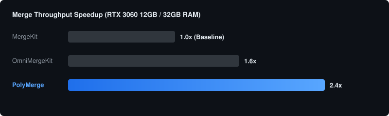
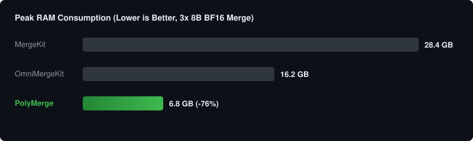

<div align="center">


# PolyMerge

**High-performance, architecture-agnostic Large Language Model merging, upcycling, and pruning engine.**

[](https://github.com/ehristoforu/polymerge/actions)
[](LICENSE)
[](https://python.org)
[](https://huggingface.co)
[](notebooks/PolyMerge_Interactive_Colab.ipynb)

</div>

---

## Overview

PolyMerge is a unified engine for combining, transforming, and compressing Large Language Models at the raw tensor level. It eliminates framework-level dependencies on model classes, enabling immediate support for any current or newly released architecture without upstream updates.

### Key Capabilities

- **Zero-Class Architecture Agnostic**: Direct tensor streaming across SafeTensors and GGUF files without instantiating modeling code.
- **Vision Layer Isolation**: Automatic regex filtering of multimodal/vision layers (`visual.*`, `vision_tower.*`, `mm_projector.*`).
- **Modern Merge Algorithms**: Includes `linear`, `slerp`, `nuslerp`, `karcher`, `nearswap`, `task_arithmetic`, `ties`, `dare_ties`, `della`, `omnimerge_v2`, `model_stock`, and `sce`.
- **Sanity Audit & Collapse Diagnostics**: In-flight verification of NaN/Inf parameters and MoE router matrix condition numbers to prevent runtime degeneration.
- **Auto-Quantize & Hugging Face Hub Publication**: One-command export to quantized GGUF (`--quantize`) and direct repository publishing (`--push-to-hub`).
- **Parameter Evolution Grid**: Parameter search optimization across mixing ratios and densities.
- **Universal MoE Upcycling**: Assembles sparse Mixture-of-Experts models from dense checkpoints (Mixtral, Qwen, DeepSeek, Gemma 4).
- **Zero-Backprop Pruning**: Dense layer removal with local residual healing and MoE expert pruning with T18 Soft-Transfer router recovery.
- **Complete LoRA Toolkit**: Truncated SVD extraction, in-place base baking, and multi-adapter combination.
- **Memory & Staging Optimization**: Sequential chunked I/O with page-cache eviction and multi-pass staged pipelines for memory-constrained hardware.

---

## Benchmarks

Measurements conducted on consumer hardware (**NVIDIA GeForce RTX 3060 12GB VRAM / 32GB System RAM**), merging three 8B BF16 models.

<div align="center">



<br/>



</div>

---

## Comparison

| Feature | Standard Tools | Single-Task Scripts | **PolyMerge** |
|:---|:---:|:---:|:---:|
| **Zero-Class Architecture Support** | No | Partial | **Full** |
| **Multimodal / Vision Auto-Filter** | No | Manual | **Automatic** |
| **All 9 Modern Merge Algorithms** | Partial | Partial | **Full** |
| **MoE Upcycling (Dense to MoE)** | Limited | No | **Full (4 Targets)** |
| **Shared Expert Support** | No | Limited | **Native** |
| **Zero-Retraining Pruning** | No | Script-based | **Integrated** |
| **Direct GGUF Merging** | No | External | **Native** |
| **LoRA SVD Extract & Bake** | Partial | No | **Integrated** |
| **Low-RAM Multi-Stage Pipeline** | No | No | **Native** |
| **Hardware Routing** | CPU/GPU | CPU/GPU | **CPU / GPU / TPU** |

---

## Installation

```bash
git clone https://github.com/ehristoforu/polymerge.git
cd polymerge
pip install -e .[all]
```

---

## Quick Usage

### Model Merging
```bash
polymerge examples_configs/omnimerge_v2_qwen.yaml -o ./merged_model
```

### MoE Upcycling
```bash
polymerge examples_configs/moe_qwen_shared_expert.yaml -o ./assembled_moe --moe
```

### Model Pruning
```bash
# Dense layer pruning with residual healing
polymerge --prune-dense --base meta-llama/Llama-3.2-1B -o ./pruned_model --drop-fraction 0.2

# MoE expert pruning with soft-transfer router recovery
polymerge --prune-moe --base google/gemma-4-26B-A4B-it -o ./gemma_64e --target-experts 64 --alpha 0.3
```

### LoRA Operations
```bash
# SVD LoRA extraction
polymerge --extract-lora --base /path/base --tuned /path/tuned -o ./my_lora --rank 16

# Direct bake into base
polymerge --merge-lora --base /path/base --adapter ./my_lora -o ./baked_model
```

---

## Documentation

Detailed technical documentation and mathematical formulations:
- [Merge Methods & Formulas](docs/MERGE_METHODS.md)
- [MoE Upcycling Architecture](docs/MOE_UPCYCLING.md)
- [Model Pruning & Recovery](docs/PRUNING.md)
- [Layer Slicing](docs/LAYER_SLICING.md)
- [LoRA Tools](docs/LORA_TOOLS.md)
- [Tokenizer Alignment](docs/TOKENIZER.md)
- [Hardware & Optimization](docs/HARDWARE_OPTIMIZATION.md)
- [CLI Reference](docs/CLI_REFERENCE.md)

---

## Upstream Acknowledgements

PolyMerge integrates and expands upon algorithms and research from the open-source community:
- **[OmniMergeKit](https://github.com/omnimergekit/omnimergekit)**: Tensor-level streaming architecture, Omnimerge v2, and router recovery algorithms.
- **[MergeKit](https://github.com/arcee-ai/mergekit)**: Merge methods, task arithmetic, and YAML configuration design.
- **[MergeKitty](https://github.com/cg123/mergekitty)**: Advanced adapter handling and layer manipulation.
- **[Mergoo](https://github.com/mergoo-ai/mergoo)**: Initial MoE composition paradigms.
- **[MergeUI](https://github.com/mergeui/mergeui)**: Visual merging and graph schema design.

Detailed references and paper citations are provided in [ACKNOWLEDGEMENTS.md](ACKNOWLEDGEMENTS.md).

---

## License

This project is licensed under the [GNU General Public License v3.0](LICENSE).
